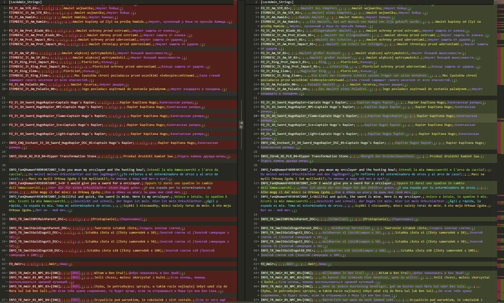

# Gothic 3 Union+ translations


### Visual Studio Code recommented settings
Install [Rainbow CSV plugin](https://marketplace.visualstudio.com/items?itemName=mechatroner.rainbow-csv) and add lines below to your settings.json file. 
```
"files.associations": {
    "stringtable.ini": "csv (semicolon)"
}
```


### Translation progress

<!-- START:translation-progress -->
### QuestPaket


### BaseMod


### QP Mini Quests


### ContentModBase


### CM Animal & Mushroom Retexture


### CM End Game


### Orc Mod Lite


### Orc Mod Full


### UpdatePack_SupportMod


### Smart Monsters Skins


### QP Texture Pack


### PreAlpha


### Myrtana Tekstures Pack


### Autumn Textures


### Smart Texture Pack


### World Texture Mix


### QuestFix Mod


### Main


### Consequences


### CNQLeadership


### LivelyTownsMod


### Pirate Dream


### RGL


### LTMSmeltingMod


### TameAnimal


### LTMTeleportNPCMod


### CNQArenas


### CNQDragons


### CNQMoreTeleportationStones


### CNQThiefQuests


### Conquest


### CNQMagicWeapons


### Knight Chronicle


### DRAGONS REWARDS


### Immersive World


### Immersive Cook


### Alternative Balance Uncapped


### EnchantStones


### TRLimitedSleep


### TRLimitedStatues


### Extended Frying


### Achievements


### Quest Edit


### Alternative Pickpocketing


### Alternative Bonuses


### New Balance and Combat


### New Magic for NPCs Mod


### Balance Ultimate


### TotalRebalance


### TotalRebalance & ShieldRebalance


### CasualRebalance


### Alternative World


### CNQEasyPaladin


### Text Fix


<!-- END:translation-progress -->
